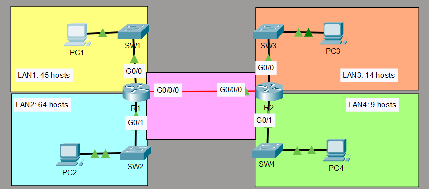

# VLSM Addressing and Static Routing Lab

A Cisco Packet Tracer lab where one /24 network is divided into five variable-length subnets, and two routers are connected with static routes so every PC can reach every other PC.

**Skills practised:** VLSM subnetting, IPv4 addressing, router and PC interface configuration, static routing, connectivity testing and verification.

**Tools:** Cisco Packet Tracer

## Objective

- Subnet `192.168.5.0/24` so each LAN has enough addresses, plus the point-to-point link between R1 and R2.
- Assign the **first usable address** to the PC in each LAN.
- Assign the **last usable address** to the router interface in each LAN.
- Configure static routes on both routers so all PCs can ping each other.

## Topology



| LAN | Hosts required | Connected to |
|---|---|---|
| LAN1 | 45 | R1 G0/0 via SW1 |
| LAN2 | 64 | R1 G0/1 via SW2 |
| LAN3 | 14 | R2 G0/0 via SW3 |
| LAN4 | 9 | R2 G0/1 via SW4 |
| Link | 2 | R1 G0/0/0 <-> R2 G0/0/0 |

## Subnetting Design

The router interface also needs an address in each LAN, so each requirement is hosts + 1. Subnets were allocated from largest to smallest so every block starts on a valid boundary.

| Subnet | Required | Prefix | Mask | Network | First usable | Last usable | Broadcast |
|---|---|---|---|---|---|---|---|
| LAN2 | 65 | /25 | 255.255.255.128 | 192.168.5.0 | 192.168.5.1 | 192.168.5.126 | 192.168.5.127 |
| LAN1 | 46 | /26 | 255.255.255.192 | 192.168.5.128 | 192.168.5.129 | 192.168.5.190 | 192.168.5.191 |
| LAN3 | 15 | /27 | 255.255.255.224 | 192.168.5.192 | 192.168.5.193 | 192.168.5.222 | 192.168.5.223 |
| LAN4 | 10 | /28 | 255.255.255.240 | 192.168.5.224 | 192.168.5.225 | 192.168.5.238 | 192.168.5.239 |
| R1-R2 link | 2 | /30 | 255.255.255.252 | 192.168.5.240 | 192.168.5.241 | 192.168.5.242 | 192.168.5.243 |

Unused space: 192.168.5.244 - 192.168.5.255 (available for future growth).

## Device Addressing

| Device | Interface | IP address | Mask | Default gateway |
|---|---|---|---|---|
| PC1 | NIC | 192.168.5.129 | 255.255.255.192 | 192.168.5.190 |
| PC2 | NIC | 192.168.5.1 | 255.255.255.128 | 192.168.5.126 |
| PC3 | NIC | 192.168.5.193 | 255.255.255.224 | 192.168.5.222 |
| PC4 | NIC | 192.168.5.225 | 255.255.255.240 | 192.168.5.238 |
| R1 | G0/0 (LAN1) | 192.168.5.190 | 255.255.255.192 | n/a |
| R1 | G0/1 (LAN2) | 192.168.5.126 | 255.255.255.128 | n/a |
| R1 | G0/0/0 (link) | 192.168.5.241 | 255.255.255.252 | n/a |
| R2 | G0/0 (LAN3) | 192.168.5.222 | 255.255.255.224 | n/a |
| R2 | G0/1 (LAN4) | 192.168.5.238 | 255.255.255.240 | n/a |
| R2 | G0/0/0 (link) | 192.168.5.242 | 255.255.255.252 | n/a |

## Static Routes

| Router | Destination | Mask | Next hop |
|---|---|---|---|
| R1 | 192.168.5.192 (LAN3) | 255.255.255.224 | 192.168.5.242 |
| R1 | 192.168.5.224 (LAN4) | 255.255.255.240 | 192.168.5.242 |
| R2 | 192.168.5.0 (LAN2) | 255.255.255.128 | 192.168.5.241 |
| R2 | 192.168.5.128 (LAN1) | 255.255.255.192 | 192.168.5.241 |

Full configs are in the [`configs/`](configs) folder.

## Verification

Commands used:

```
show ip route
show ip interface brief
ping <destination>
traceroute <destination>
```

Test results:

| Test       |Expected | Result |
|---         |---      |---     |
| PC1 -> PC2 | Success | Success|
| PC1 -> PC3 | Success | Success|
| PC1 -> PC4 | Success | Success|
| PC2 -> PC3 | Success | Success|
| PC2 -> PC4 | Success | Success|
| PC3 -> PC4 | Success | Success|


## What I Learned

- Why VLSM saves addresses compared with fixed-size subnets
- Why the router interface must be counted when sizing a subnet
- How static routes need to exist in both directions for a ping to succeed

---
*Lab exercise based on my CCNA course.*
